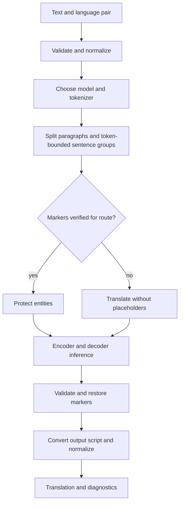

# NLP pipeline

The application uses a pretrained IndicTrans2 model for translation. The surrounding JavaScript stages are deterministic preprocessing and postprocessing helpers; they are not additional trained language models.

## Modules

| Module                 | Role                                                                                                                                                                          | Input and output                                                            |
| ---------------------- | ----------------------------------------------------------------------------------------------------------------------------------------------------------------------------- | --------------------------------------------------------------------------- |
| `preprocessing.js`     | Validate supported, distinct languages; reject empty/control-only text; apply NFC and whitespace normalization; enforce the 20,000 JavaScript string-unit limit.              | User text and route to validated normalized text or errors.                 |
| `language.js`          | Map UI labels to IndicTrans2 language tags.                                                                                                                                   | Language label/code to canonical code.                                      |
| `modelRouter.js`       | Select English-to-Indic, Indic-to-English, or Indic-to-Indic model family and its local graph/tokenizer paths.                                                                | Source and target codes to model configuration.                             |
| `sentenceSegmenter.js` | Find sentence boundaries and group adjacent sentences within the active tokenizer's source-token limit. Paragraph boundaries are retained.                                    | Paragraph and tokenizer callback to bounded chunks.                         |
| `entityProtection.js`  | Heuristically detect URLs, email, dates/times, currency, decimals, phone numbers, and alphanumeric IDs; protect/restores exact values only when route verification allows it. | Text to candidate entities, protected text, and validated restoration.      |
| `markerSupport.js`     | Store the tested route gates. Entity placeholders are enabled only for Kannada-to-English; glossary placeholders are off for all routes.                                      | Language pair to support flags.                                             |
| `glossary.js`          | Store local terminology, support CRUD, and match longest phrases with Unicode-aware boundaries.                                                                               | Text and pair to candidate terms; actual substitution follows marker gates. |
| `translator.js`        | Load local Transformers.js tokenizers and ONNX sessions, add language tags, encode, autoregressively decode, reuse decoder key/value cache, and dispose tensors.              | Token-bounded source chunk and model config to translated text and timing.  |
| `postprocessing.js`    | Convert between Tamil/Kannada and the model's shared Indic representation; normalize Unicode and output whitespace.                                                           | Decoded text and target code to target-script text.                         |
| `nlpPipeline.js`       | Coordinate validation, model/tokenizer setup, segmentation, optional marker protection, inference, restoration, postprocessing, and diagnostics.                              | User request to translation plus per-stage detail.                          |
| `editDistance.js`      | Calculate Levenshtein distance for optional English spelling suggestions. Suggestions do not change input automatically.                                                      | English words and vocabulary to candidate corrections.                      |
| `app.js`               | Render the interface, connect events, display diagnostics, history, glossary, and progress.                                                                                   | Browser events and pipeline results to UI updates.                          |

## Limits and diagnostics

Character count uses JavaScript string length (UTF-16 code units). A long input is split into multiple sequential model calls, so the 20,000-unit input limit does not imply one inference call or a fixed completion time. The segmenter counts actual source tokenizer tokens, including language tags, and safely rejects a chunk exceeding the active model limit.

Entity protection is attempted only for Kannada-to-English after exact marker round-trip checks. Glossary entries are stored locally, but automatic glossary replacement is disabled on every route because its marker form did not pass integration checks. Diagnostics omit those inactive rows in normal use. These heuristics and route gates are covered by `evaluation/nlp_component_tests.json` and `evaluation/nlp_pipeline_tests.json`.
