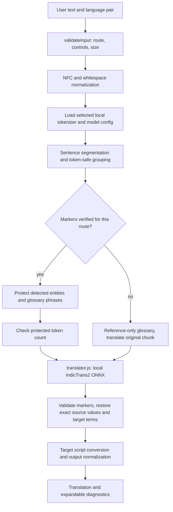

# Stage 3 NLP pipeline

The Stage 2 IndicTrans2 ONNX models and `translator.js` remain the translation engine. `nlpPipeline.js` coordinates preparation, token-safe chunking, optional reversible terminology protection, inference, restoration, and diagnostics.

## Module boundaries

- `preprocessing.js` validates route/input, normalizes to Unicode NFC, folds horizontal whitespace, preserves paragraph boundaries and Indic join controls, and rejects unsupported control characters. The character limit is 20,000.
- `sentenceSegmenter.js` uses `Intl.Segmenter` where available and a punctuation-aware fallback. Adjacent sentences stay grouped until actual model-tokenizer counts reach the model's configured `max_source_positions`. Paragraphs remain separate. The tokenizer count includes the source and target language tags.
- `entityProtection.js` detects conservative regex patterns (URLs, email, dates/times, currency, decimals, phone numbers, and alphanumeric IDs). A restoration is all-or-nothing per chunk: every expected marker must occur once and no unexpected entity marker may appear.
- `glossary.js` provides six-direction sample terminology and localStorage CRUD. It prefers longest phrase matches and uses Unicode letter/number boundaries. Protection is gated by route-level marker verification; otherwise the entries remain a reference list.
- `translator.js` is still the sole inference implementation. It exposes actual source-token counting and the active model's positional limit to the pipeline.
- `postprocessing.js` performs target-script conversion and NFC/output whitespace normalization while retaining paragraph breaks.
- `editDistance.js` provides Levenshtein distance and optional suggestions from a small English-only word list. It never edits text automatically.
- `app.js` renders the compact diagnostics, glossary controls, and optional suggestions.

## Diagnostics

The panel reports normalized input, chunk/sentence counts, selected model family, detected entities, whether restoration succeeded, glossary matches/reference count, actual source and generated tokens, warnings, and preprocessing/inference/postprocessing durations. Marker support is not inferred from regex tests: it is enabled only for directions that pass the browser test against the bundled ONNX model and then pass an end-to-end glossary restoration check. See [the recorded evaluation](../../evaluation/nlp_pipeline_tests.json).

The model's source limit is read from its local `config.json` at load time rather than hard-coded by the NLP pipeline. A protected chunk is token-counted again before inference; an over-limit chunk fails safely rather than entering the model. Entity markers and glossary markers have separate route gates because the models can preserve one marker form but alter another. Current verified support is recorded in `markerSupport.js`; the actual-model probes and restoration outcomes are in [the evaluation JSON](../../evaluation/nlp_pipeline_tests.json).
